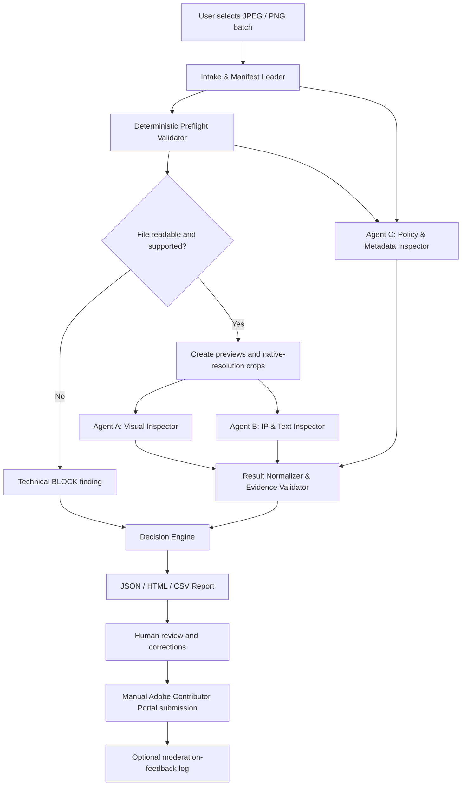

# Adobe Stock QC AI Agent — Complete Build Plan

**Document version:** 1.0.0  
**Plan date:** 2026-10-22  
**Target:** Local-first pre-submission QC assistant for Adobe Stock still images  
**Initial scope:** JPEG photos and transparent PNGs  
**Architecture:** Python orchestrator + deterministic validators + 3 logical specialist agents  
**Explicitly excluded:** Similarity checks, Adobe Stock catalog comparison, portfolio clustering, automatic submission/upload, and claims that an asset is guaranteed to be accepted by Adobe.

---

## 1. Executive summary

Build a local-first application that inspects JPEG/PNG assets before the user manually submits them to Adobe Stock. It should detect technical failures, likely visual defects, visible text/IP indicators, metadata problems, and missing/unknown compliance facts. Every finding must be traceable to evidence and either an official Adobe rule or a clearly identified internal heuristic.

The application is not an Adobe moderation simulator and cannot guarantee acceptance. It is a risk-reduction tool. Pixels alone cannot establish a person's identity, the truth of an asset's provenance, whether an AI tool's license grants the required rights, or whether a release is valid. The system must therefore preserve `UNKNOWN` and route uncertainty to human review rather than fabricating answers.

The design uses **three logical sub-agents** that can run in parallel after cheap deterministic checks:

1. **Visual Inspector** — subject/anatomy/object integrity, focus, exposure, color, noise, artifacts, transparency edges, composition signals.
2. **IP & Text Inspector** — OCR, unintended text, watermarks, logos/brands and other visible IP indicators; findings are risk flags, not legal conclusions.
3. **Policy & Metadata Inspector** — applies the rulebook to the asset type, prompt/provenance manifest, release records, title, keywords, category and user confirmations.

A Python technical validator runs before the agents. A deterministic Decision Engine merges their structured results into `BLOCK`, `REVIEW`, or `READY`. The orchestrator manages concurrency, retries, caching, cancellation, logging and report generation.

### Success definition

For a batch of JPEG/PNG assets, the application can:

- load files safely and preserve original bytes;
- identify confirmed technical failures using deterministic rules;
- obtain evidence-backed visual and IP/text findings;
- evaluate policy facts without silently assuming missing values;
- emit schema-valid JSON and a readable HTML/CSV report;
- show the reason and source behind every rule-based finding;
- ask the user to resolve unknown provenance/release/declaration items;
- avoid similarity checks and avoid submitting files to Adobe automatically.

---

## 2. Scope and non-goals

### In scope — MVP

- JPEG photo assets and PNG assets intended for transparent-background submission.
- Batch intake from a user-selected folder.
- Deterministic file checks: decodability, dimensions, megapixels, file size, format, ICC/profile information, alpha channel and PNG transparency diagnostics.
- Visual QC with whole-image inspection and targeted crops at native pixel detail.
- OCR/text/logo/watermark risk screening.
- Rulebook-based technical, generative-AI, visible-IP, release, metadata and content-type checks.
- User confirmation workflow for facts the system cannot infer.
- Reports in JSON and HTML, plus CSV summary/export for triage.
- Versioned rulebook and source catalog.
- Cached results and bounded parallel processing.
- Human review and a feedback field for actual Adobe moderation outcomes.

### Explicitly out of scope in this version

- Similarity/deduplication against Adobe Stock's catalog or the user's portfolio. Do not implement pHash, embedding similarity, clustering, or a “similarity score” in this scope.
- Automatic uploading/submission, automated clicking of final declarations, or automatic account actions.
- Legal clearance or automatic determination that an image is copyright-safe.
- Inferring AI provenance solely from a generic AI-image detector.
- Automatic repair/inpainting or destructive editing of the original file.
- Vector and video QC; support can be added in a later phase using their own technical rule sets.
- Training a custom vision model in the MVP.

---

## 3. Core design principles

1. **Official policy is not the same as a heuristic.** Every rule has a `source_class`: `official_adobe`, `internal_heuristic`, `research_background`, or `unknown`.
2. **Deterministic first.** Do cheap, reliable file/rule checks before paying for vision-model calls.
3. **Parallel where independent.** Run the three specialist agents concurrently only after shared inputs and preflight are ready.
4. **Evidence before verdict.** A visual finding must provide a concrete observation and a crop/region when possible.
5. **Unknown is a real state.** Missing provenance, unclear identity, and incomplete release facts remain `UNKNOWN`; never infer “fictional” from the absence of a release.
6. **Separate finding status from batch decision.** Individual checks use `PASS`, `FAIL`, `REVIEW`, `UNKNOWN`, or `NOT_APPLICABLE`; the asset verdict is `BLOCK`, `REVIEW`, or `READY`.
7. **No universal model thresholds.** Do not hard-code a universal Laplacian blur threshold or uncalibrated model-confidence cutoff as an Adobe rule.
8. **No automatic legal conclusion.** OCR, logo detectors and VLM outputs are indicators. Risky or ambiguous cases go to review.
9. **Preserve originals.** QC is read-only. Suggested repairs are separate instructions; the app does not overwrite originals.
10. **READY is limited.** The phrase is “no known issue detected by configured checks,” never “Adobe will accept this.”
11. **Auditable policy.** Keep policy versions, rule IDs, URLs, retrieval/review dates, and prior versions.
12. **Privacy by design.** Use local tools first where practical. Before sending images to a hosted model, disclose the configured provider and require an appropriate user setting/consent.

---

## 4. High-level architecture



### Components

- **UI:** local batch picker, queue progress, findings list, crop viewer, rule details, user confirmation form, report export.
- **Orchestrator:** schedules jobs, enforces concurrency/timeouts, handles retries and cancellation, tracks states.
- **Preflight service:** deterministic file and metadata validation.
- **Agent A — Visual Inspector:** general image-quality and visual-defect reasoning.
- **Agent B — IP & Text Inspector:** OCR/text, watermark, logo/brand and known-restriction indicators.
- **Agent C — Policy & Metadata Inspector:** maps known facts and asset metadata to rulebook requirements.
- **Decision Engine:** deterministic aggregation; no LLM makes the final decision alone.
- **Rulebook Store:** versioned structured JSON plus source catalog.
- **Report Service:** JSON Schema validation, HTML report and CSV summary.
- **Persistence:** SQLite initially; filesystem for originals, generated crops and reports.
- **Model Provider Adapter:** one interface for vision and language providers, allowing model changes without changing orchestration logic.

---

## 5. Recommended initial technology stack

Choose the simplest stack that remains modular. Pin versions only after a clean environment test on the target Windows machine.

### Backend

- Python 3.12 or another currently supported version confirmed compatible with selected packages.
- Pydantic for typed inputs/outputs.
- `jsonschema` for validating the final report against the library's JSON Schema.
- Pillow for image decoding, dimensions, color-profile and alpha inspection.
- OpenCV for non-authoritative image signals (blur, clipping, edge halos, etc.).
- ExifTool as an optional external utility for deeper metadata inspection.
- `asyncio` plus a bounded semaphore/task queue for concurrency.
- SQLite for jobs, user confirmations, findings, source/rule versions, cache entries and review labels.
- OCR provider abstraction (e.g. local Tesseract/EasyOCR or configured OCR service); OCR output always remains fallible.
- Model provider adapter for vision-language calls; do not bind business logic to one provider's SDK.

### UI recommendation

For fastest MVP, use a local web UI such as Streamlit, or a lightweight FastAPI backend with a basic frontend. Keep the business logic in UI-independent Python modules so the UI can later be replaced by React or a desktop shell.

### Outputs

- `report.json` — authoritative structured results.
- `report.html` — readable review interface and thumbnails/crops.
- `summary.csv` — one row per file with verdict and finding counts.
- `evidence/` — generated preview and evidence crop files, associated with finding IDs.
- `run_manifest.json` — versions, checks performed, model/provider identifiers and execution settings.

### Configuration

Keep secrets in environment variables or a local secret manager; never store API keys in source control or reports. A `.env.example` may document variable names but must not contain real credentials.

---

## 6. Agent contracts and responsibilities

All three agents return structured JSON through the same normalized `AgentResult` contract. They do not return only free-form prose.

### Agent A — Visual Inspector

**Purpose:** detect probable visual defects affecting stock suitability.

Checks include:

- human anatomy and proportions (hands, fingers, limbs, face, eyes, teeth, ears, joints);
- animal anatomy and features;
- object geometry and integrity (fused, duplicated, melted, missing or impossible parts);
- texture discontinuities and synthetic-looking local artifacts;
- focus/softness on the primary subject;
- clipping or loss of detail due to exposure;
- white balance and unnatural color correction;
- noise, compression artifacts, oversharpening, haloing and excessive smoothing;
- shadow/reflection coherence as a heuristic;
- PNG cutout edges, alpha halos, jagged/matted boundaries and baked checkerboard patterns;
- composition issues only as advisory signals, never as an invented hard policy.

**Required behaviour:** inspect whole-image context first; inspect relevant crops at native pixel detail; identify what is observed versus inferred; return `uncertain` if evidence is not visible. A crop should not be upscaled and then presented as proof of detail that did not exist in the source.

**Not responsible for:** proving source provenance, deciding legal status, or determining whether Adobe will accept the image.

### Agent B — IP & Text Inspector

**Purpose:** identify visible-risk indicators for human/compliance review.

Inputs: image preview, OCR results, rulebook restriction watchlist and optional object/logo-detector results.

Checks include:

- readable or pseudo-readable text in scenes, clothing, packaging or signage;
- visible watermark, timestamp, logo, brand name or trademark;
- potentially restricted product shape, distinctive design, artwork, sculpture, graffiti or location indicator;
- conflicts between text/logo observations and title/keywords.

**Required behaviour:** include exact OCR span or a crop/bounding box where possible. Match watchlist entries with context. Distinguish `detected_text` from `likely_brand_match` and from `confirmed_policy_violation`. No match is not proof that the image is free from IP risk. Removing a logo must not automatically clear the underlying product/design.

**Not responsible for:** legal determination or automatic inpainting.

### Agent C — Policy & Metadata Inspector

**Purpose:** apply relevant rules to known asset facts and surface missing facts.

Inputs:

- image metadata and technical preflight result;
- title, keywords, content category and planned submission type;
- user-supplied provenance manifest (AI tool/model/version, prompt, reference sources, editing workflow and license notes);
- release-document presence and asset mapping (not an automatic legal validation of signature/authenticity);
- current rulebook and source catalog.

Checks include:

- required AI declaration according to the documented workflow and official guidance;
- whether the correct photo/illustration category is indicated for the content;
- prompt/title/keyword restrictions concerning artist names, real/known people, fictional characters, protected creative works, third-party IP or misleading news-event claims;
- rights/license evidence for the AI tool and references;
- model/property release requirements and unresolved facts;
- title accuracy, character-count recommendation, keyword count, duplication/relevance and alignment with visible content;
- rule version/date and source traceability.

**Required behaviour:** if the manifest or user confirmation is missing, return `UNKNOWN` or `REVIEW`. Never infer fictional people/property solely because a release document is absent. Do not delete keywords automatically without presenting the proposed correction and reason.

**Not responsible for:** guessing unseen prompt history, guaranteeing a tool's legal terms, or clicking final Contributor Portal declarations.

### Orchestrator — not a fourth judgment agent

The orchestrator handles routing, batching, timeouts, retries, caching, model/provider configuration and state transitions. It should be primarily deterministic code, not a free-running LLM. It must not allow a sub-agent to override confirmed hard failures from another component.

---

## 7. End-to-end processing flow

### Stage 0 — User selects a batch

1. User selects one folder or several files.
2. Validate the path and file extension; do not execute embedded files or follow unexpected symlinks outside the chosen scope.
3. Create a run ID and read-only snapshot/manifest.
4. Ask for missing batch-level details only when applicable: content creation method, AI tool/license evidence availability, desired submission type, metadata language.
5. Allow incomplete manifests, but carry unknowns forward as explicit states.

### Stage 1 — Deterministic preflight

For each file:

- verify file readability and decode safety;
- detect actual format instead of trusting extension alone;
- measure width, height and megapixels;
- measure file size;
- read ICC/color profile where available;
- inspect alpha channel and PNG transparency;
- identify EXIF/IPTC text or timestamps where relevant;
- check watermark/timestamp/branding signals with lightweight methods;
- compare applicable values with the versioned technical rule for this asset type.

If a file is corrupt, unsupported or fails a confirmed technical hard requirement, create a finding without calling vision models. Do not apply photo rules to PNG, vector or video incorrectly.

### Stage 2 — Build visual inspection inputs

- Create a display-sized preview without replacing the original.
- Keep original dimensions and a mapping from normalized coordinates to original pixels.
- Use cheap detectors/metrics to propose regions: face/hand/animal/object regions, text regions, high-contrast boundaries, suspected blur/halo areas and transparent edges.
- Metrics are signals to guide inspection, not universal hard thresholds.
- Keep crop coordinates, crop ID, source image hash and crop-generation method.

### Stage 3 — Parallel specialist checks

Start Agents A, B and C concurrently when their inputs are available.

- Agent A gets preview, file metrics and relevant crops.
- Agent B gets preview, OCR/detection output and restriction-watchlist snippets relevant to detections.
- Agent C gets metadata, manifest, technical facts, applicable rulebook entries and user-confirmed facts.

Use bounded concurrency per image and per batch. Avoid redundant LLM calls: a sub-agent should receive only its role-specific context and the relevant rule excerpts, not the entire knowledge library on every call.

### Stage 4 — Normalize and validate agent findings

For each response:

1. Parse JSON; reject or retry malformed responses a limited number of times.
2. Validate against the internal finding schema.
3. Verify `rule_id` and `source_ids` exist in the local catalogs where required.
4. Require an observation, evidence type, suggested action and review flag.
5. If a visual finding lacks a visible region/evidence, downgrade it to `REVIEW`/`UNCERTAIN` rather than treating it as a confirmed fact.
6. Separate “not checked” from “passed.”

### Stage 5 — Decision Engine

Use deterministic rules, not another unconstrained LLM prompt.

- `BLOCK` when there is a confirmed hard technical failure or a confirmed violation of an applicable hard policy.
- `REVIEW` when legal facts, provenance, model/property release, IP interpretation or visual evidence is uncertain, or when mandatory checks did not complete.
- `READY` only when all configured mandatory checks completed and no known issue remains. Display “No known issues detected by configured checks; Adobe acceptance is not guaranteed.”

A high-severity *possible* violation is `REVIEW`, not `BLOCK`, unless evidence and policy establish it as confirmed. A missing required check cannot count as `PASS`.

### Stage 6 — Human review and correction

For each finding show:

- thumbnail and crop(s);
- rule/check ID and severity;
- exact observation and why it matters;
- source class and policy link;
- recommended action;
- available user decisions: confirm issue, dismiss with reason, provide missing evidence, mark as corrected, or leave unresolved.

If the file is edited externally, the edited file must be treated as a new file/hash and run through the relevant checks again. Never overwrite the original.

### Stage 7 — Export and manual submission

- Generate JSON, HTML and CSV outputs.
- Include the final file path/hash and QC run ID.
- Keep a final checklist for AI label, fictional-person/property statement and releases that are applicable to the asset.
- The user submits manually through Adobe Contributor Portal and checks the relevant portal declarations themselves.
- Do not implement an unsupported Contributor upload API or automate clicking declarations.

### Stage 8 — Feedback log

Optionally let the user record Adobe's actual moderation result and stated refusal reason. Store this as historical feedback, not a guaranteed causal label. A rejection may be explained only generally; do not conclude that a single detector was definitively responsible when Adobe did not say so.

---

## 8. Rulebook design and source governance

Use the existing knowledge library as the starting content:

- `rulebook/adobe_stock_rulebook.json`
- `rulebook/adobe_stock_rulebook.md`
- `rulebook/rule_index.csv`
- `rulebook/known_restrictions_watchlist.json`
- `sources/sources.json`
- `sources/source_catalog.md`
- `sources/source_catalog.csv`
- `visual_qc/visual_qc_taxonomy.json`
- `visual_qc/visual_qc_index.csv`
- `visual_qc/visual_qc_pipeline.md`
- `prompts/visual_inspector_system_prompt.md`
- `schemas/qc_report.schema.json`
- `examples/qc_report_example.json`

### Every rule should carry

- `rule_id` (stable ID; do not recycle it);
- `domain` and `asset_types`;
- `title` and concise requirement;
- `source_class` (`official_adobe`, `internal_heuristic`, `research_background`, `unknown`);
- `source_ids` and canonical source URL;
- `source_checked_at` and live page update date if available;
- `applicability` / conditions;
- `severity` and handling (`INFO`, `REVIEW`, `BLOCK_IF_CONFIRMED`, etc.);
- `automation_mode` (`deterministic`, `model_assisted`, `user_confirmation`, `manual_review`);
- a plain-language rationale and remediation steps;
- tests/examples validating the rule.

### Source update workflow

1. Review official Adobe source pages at least monthly and whenever a known refusal reason suggests a change.
2. Save source title, URL, retrieval date, any displayed update date, relevant excerpt and a hash of the stored snapshot.
3. Compare against prior version and make a change log.
4. Require human approval before changing an official rule's operational effect.
5. Never silently turn a heuristic into an official policy.
6. Treat the Known Restrictions list as non-exhaustive and live; no local list can be called complete.

### Rule conflict handling

- Prefer the most specific applicable official Adobe source over a general summary.
- If official Adobe sources appear inconsistent, preserve the conflict in the source catalog and use a conservative operational rule (usually `REVIEW`) rather than pretending the conflict is resolved.
- Store the operational choice and explain why it was made.

---

## 9. Data contracts

Keep three distinct entities: `AssetRecord`, `Finding`, and `QCReport`.

### AssetRecord (conceptual)

```json
{
  "asset_id": "asset_0001",
  "file_name": "image_0001.jpg",
  "absolute_path": "local path stored privately",
  "sha256": "computed hash",
  "asset_type": "photo_jpeg",
  "manifest": {
    "is_generative_ai": "unknown",
    "tool_name": null,
    "tool_version_or_model": null,
    "prompt": null,
    "reference_sources": [],
    "commercial_rights_evidence": "unknown",
    "recognizable_person_or_property": "unknown",
    "release_status": "unknown"
  }
}
```

This is illustrative. Avoid including private absolute paths in reports exported for sharing unless the user explicitly opts in.

### Finding (conceptual)

```json
{
  "check_id": "VIS_ANATOMY_HAND_001",
  "rule_id": "AS-VIS-004",
  "status": "REVIEW",
  "severity": "MEDIUM",
  "source_class": "internal_heuristic",
  "source_ids": ["source_adobe_quality_guidance"],
  "confidence": 0.78,
  "confidence_calibrated": false,
  "evidence_type": "crop",
  "region": {"x": 0.42, "y": 0.31, "width": 0.12, "height": 0.18},
  "observation": "Possible fused fingers; detail needs human confirmation.",
  "why_it_matters": "Visible generative artifacts can reduce technical quality.",
  "suggested_action": "Inspect crop at native pixel detail; correct externally if confirmed.",
  "requires_human_review": true
}
```

The coordinate example is illustrative and normalized to 0–1. Scores from a model are not calibrated probabilities unless calibrated on a held-out evaluation set.

### QCReport

Use the existing `schemas/qc_report.schema.json` as a starting schema. Before implementation, test and if needed refine it to require:

- schema/report version and run ID;
- asset identifier and safe file fingerprint;
- asset type and decision summary;
- all individual checks, including skipped/not-applicable checks;
- source/rule traceability;
- technical measurements;
- user confirmations and remaining unknowns;
- agent/model/provider versions and prompt version IDs;
- timestamp and timings;
- limitations disclaimer;
- final decision and the exact reasons for that decision.

Do not make provider-specific response text the source of truth. Normalize it into the internal contract first.

---

## 10. Decision matrix

| Condition | Check result | Asset decision effect |
|---|---|---|
| File is corrupt or unsupported | Confirmed deterministic failure | `BLOCK` until replaced/fixed |
| Dimensions/file size violate the applicable official rule | Confirmed deterministic failure | `BLOCK` until fixed |
| VLM suspects malformed hand, text or object but evidence is ambiguous | Visual observation uncertain | `REVIEW` |
| OCR detects a known brand term | Possible IP indicator | `REVIEW`; never automatic legal conclusion |
| Known restriction appears to match an object/location | Context may be uncertain | `REVIEW`; `BLOCK` only if the applicable restriction is confirmed |
| AI tool/license evidence is missing | Unknown provenance/right | `REVIEW` |
| AI-generated status is not known from workflow records | Unknown provenance | Ask user; do not infer from pixels |
| Required model/property release may be needed but status is unknown | Unknown legal fact | `REVIEW` |
| Title/keywords exceed a deterministic configured limit | Deterministic metadata result | Flag and request correction; block only if configured requirement is confirmed as hard |
| One or more mandatory agents time out or fail | Not checked | `REVIEW` / incomplete; never `READY` |
| Every mandatory check passes and no issue remains | All checks completed | `READY` with disclaimer |

Do not aggregate everything into a single score that allows good image quality to cancel a compliance problem. A “quality score” may be shown as secondary information only if clearly defined and validated.

---

## 11. Performance and cost plan

### Execution pattern

1. Run deterministic preflight synchronously or in a local worker pool.
2. Skip model calls for definite technical hard failures unless a user requests diagnostic review.
3. Run Agents A, B and C concurrently with a bounded per-batch limit.
4. For Agent A, use a two-pass pattern: whole-image review first, then targeted crops only where additional detail is needed.
5. For Agent B, run local OCR/detectors first; call a vision model only for suspicious or uncertain regions.
6. For Agent C, use deterministic rules for lengths, field presence, counts and schema checks; invoke an LLM only for semantic title/keyword/image alignment or ambiguous policy interpretation.
7. Use a single escalation pass by default. Further retries require a reason and obey a configurable maximum.

### Caching

Cache by a composite key:

`file_sha256 + agent_id + model_id + prompt_version + rulebook_version + relevant_config_hash`

Invalidate the appropriate cache when any dependency changes. A new file hash must not reuse visual QC results from the previous file. A rulebook change should re-run affected policy checks, not necessarily every image analysis.

### Reliability

- Per-agent timeout and total run timeout.
- Bounded retries with exponential backoff for transient failures.
- Do not retry permanent authentication, invalid-image or schema/configuration errors indefinitely.
- Store partial results if one agent fails, but set the final status to incomplete/`REVIEW`.
- Support cancel and resume for batches.
- Log latency and estimated token/image costs per agent and asset.
- Add a configurable daily/batch cost limit for hosted model calls.

### Batch concurrency

Concurrency is a configuration setting, not a hard-coded promise. Start low, measure throughput and provider error rates, then raise gradually. A flood of parallel calls can be slower or less reliable if the provider rate-limits them.

---

## 12. UI/UX plan

### Screen 1 — Batch setup

- Select folder/files.
- Choose asset mode: `Photo JPEG` or `Transparent PNG` (auto-detection can preselect, user can correct).
- Import metadata CSV optionally.
- Import a provenance manifest optionally.
- Choose vision/OCR providers and view privacy disclosure.
- Show enabled and disabled check modules. Similarity should not appear as enabled.

### Screen 2 — Batch progress

Per file show states: `QUEUED`, `PREFLIGHT`, `VISUAL_QC`, `IP_TEXT_QC`, `POLICY_QC`, `AGGREGATING`, `REVIEW_REQUIRED`, `DONE`, `ERROR`, `CANCELLED`.

Show progress by completed tasks, not a fabricated time-to-completion estimate.

### Screen 3 — Results dashboard

Filters: `BLOCK`, `REVIEW`, `READY`, severity, finding category and “missing user information.”

Per asset show a thumbnail, filename, final decision, total findings, main reason and agent execution state.

### Screen 4 — Finding detail

Display original preview, highlighted region/crop, observed issue, applicable rule, official/internal source class, source link, suggested action, and user resolution controls.

### Screen 5 — Provenance/compliance checklist

Present concise questions only when needed, e.g. whether content is AI-generated, which tool was used, whether commercial rights are available, whether a person/property is recognizable, and whether a relevant release exists. Preserve `unknown` until answered.

### Screen 6 — Export

Export JSON, HTML, CSV summary and evidence directory. Show a reminder that manual portal declaration and submission remain the user's responsibility.

---

## 13. Repository structure

Recommended structure for a clean application repository (the current knowledge library is copied into `knowledge/` without changing source content):

```text
adobe-stock-qc-agent/
├── README.md
├── BUILD_PLAN.md
├── pyproject.toml
├── .env.example
├── .gitignore
├── configs/
│   ├── app.yaml
│   ├── model_providers.yaml
│   └── qc_defaults.yaml
├── knowledge/
│   ├── rulebook/
│   ├── visual_qc/
│   ├── prompts/
│   ├── schemas/
│   ├── sources/
│   └── examples/
├── src/qc_agent/
│   ├── __init__.py
│   ├── app.py
│   ├── orchestrator.py
│   ├── config.py
│   ├── models.py
│   ├── decision_engine.py
│   ├── persistence/
│   │   ├── db.py
│   │   └── repositories.py
│   ├── intake/
│   │   ├── scanner.py
│   │   ├── manifest.py
│   │   └── hashing.py
│   ├── validators/
│   │   ├── image_decode.py
│   │   ├── technical.py
│   │   ├── metadata.py
│   │   └── png_alpha.py
│   ├── evidence/
│   │   ├── preview.py
│   │   ├── cropper.py
│   │   └── coordinates.py
│   ├── agents/
│   │   ├── base.py
│   │   ├── visual_inspector.py
│   │   ├── ip_text_inspector.py
│   │   └── policy_metadata_inspector.py
│   ├── providers/
│   │   ├── base.py
│   │   ├── vision.py
│   │   ├── llm.py
│   │   └── ocr.py
│   ├── rulebook/
│   │   ├── loader.py
│   │   ├── matcher.py
│   │   └── source_registry.py
│   ├── reports/
│   │   ├── json_report.py
│   │   ├── html_report.py
│   │   └── csv_report.py
│   └── ui/
│       └── local_app.py
├── tests/
│   ├── fixtures/
│   ├── unit/
│   ├── integration/
│   ├── golden_cases/
│   └── test_data_manifest.json
├── runtime/
│   ├── database/       # ignored by git
│   ├── cache/          # ignored by git
│   ├── runs/           # ignored by git
│   └── reports/        # ignored by git
└── docs/
    ├── decisions.md
    ├── privacy.md
    ├── rulebook_update_process.md
    └── testing.md
```

Do not commit user assets, releases, personal data, API keys, cache entries, or local reports. The `runtime/` directory should be ignored by version control by default.

---

## 14. Implementation phases and deliverables

### Phase 0 — Repository foundation

**Tasks**

- Create project skeleton and development environment.
- Copy the existing knowledge library into `knowledge/` without silently editing its contents.
- Add config loader and typed internal models.
- Add JSON Schema validation.
- Add logging, run IDs and test configuration.

**Acceptance criteria**

- App starts in local/dev mode.
- Library files load and required fields are validated.
- Secrets are not present in source control.
- Tests run from a clean environment.

### Phase 1 — Deterministic JPEG/PNG preflight

**Tasks**

- Folder scan and safe image decode.
- Detect actual file type.
- Dimension/MP/file-size checks based on versioned asset-type rules.
- ICC/profile and PNG alpha checks.
- Basic EXIF/IPTC inspection.
- Generate preflight findings and test with valid/invalid fixtures.

**Acceptance criteria**

- Unit tests prove boundary values are correct.
- Corrupt/unsupported images fail safely and do not crash the batch.
- Every technical result includes the measured value, applicable limit, rule ID and source ID.
- Photo rules are not accidentally applied to PNG/vector/video.

### Phase 2 — Evidence and visual QC

**Tasks**

- Create previews and native-pixel crop mapping.
- Implement provider adapter for a configured vision model.
- Integrate the structured visual inspector prompt.
- Validate VLM output against the finding schema.
- Add optional local image metrics as triage signals.
- Add targeted crop escalation and per-provider timeout handling.

**Acceptance criteria**

- Every visual flag has a concrete observation.
- Region/crop coordinates map back to the original image correctly.
- The model can return `uncertain`/`not_observable` and does so when evidence is insufficient.
- Confidence is explicitly marked uncalibrated until an evaluation set supports calibration.
- No universal blur threshold causes unconditional rejection.

### Phase 3 — OCR, text and IP risk screening

**Tasks**

- Integrate one OCR implementation behind a provider interface.
- Detect OCR spans and create region crops.
- Match detected terms against the local, versioned restriction/watchlist.
- Add optional logo/object detections if a suitable detector is available.
- Return risk indicators for human review.

**Acceptance criteria**

- An OCR absence never yields a “no IP risk” guarantee.
- A logo/watchlist match alone does not automatically produce legal clearance or deletion.
- Findings include exact text or a crop whenever possible.
- The watchlist is labeled partial and non-exhaustive.

### Phase 4 — Policy, provenance and metadata QC

**Tasks**

- Build rule applicability engine by asset type and known facts.
- Add provenance manifest import and simple user confirmation form.
- Add AI labeling guidance, tool-rights evidence, release-status fields and content-type checks.
- Add title/keyword count and consistency checks.
- Keep official rules separate from heuristics and research background.

**Acceptance criteria**

- Unknown user facts remain unknown.
- Missing release does not automatically set fictional-person/property declaration to true.
- The system only blocks confirmed hard failures; uncertain compliance cases go to review.
- Rule findings have valid source IDs and applicable conditions.

### Phase 5 — Orchestration and decision engine

**Tasks**

- Run Agents A/B/C in parallel after preflight.
- Implement concurrency limits, timeouts, retry policy and cancellation.
- Implement deterministic verdict rules.
- Add cache keys and invalidation.
- Preserve partial results and mark a run incomplete if a mandatory agent fails.

**Acceptance criteria**

- Parallel tasks do not corrupt output or cross-assign evidence between assets.
- A failed/timeout mandatory check can never silently result in `READY`.
- Confirmed hard failures cannot be overridden by an agent's positive opinion.
- Cache invalidation responds to changed file hash, prompt version, model version, relevant configuration or rulebook version.

### Phase 6 — Reports and UI

**Tasks**

- Build batch setup/progress/results screens.
- Build crop/finding detail view and user resolution controls.
- Export JSON, HTML and CSV summary.
- Add user reminders for manual portal submission.

**Acceptance criteria**

- Reports pass JSON Schema validation.
- A reviewer can identify what failed, why, where the evidence is, and which source supports the rule.
- The app preserves original files and clearly identifies derived evidence crops.
- Exported reports omit private absolute paths unless the user opts in.

### Phase 7 — Evaluation and calibration

**Tasks**

- Create a controlled evaluation set covering valid assets, known defects and ambiguous examples.
- Label each issue independently of the agent under test.
- Measure recall/false negatives, false-positive review rate, schema compliance, latency and cost.
- Calibrate thresholds only where the dataset supports it.
- Keep a golden regression set for each future prompt/model/rulebook version.

**Acceptance criteria**

- Metrics are broken down by defect family, not only one overall score.
- Evaluation separates human-confirmed policy issues from heuristic quality findings.
- New model/prompt versions run regression tests before deployment.
- Claims about performance include dataset scope and known limitations.

### Phase 8 — Maintenance and extension

**Tasks**

- Implement a monthly source-review reminder/workflow.
- Maintain policy snapshots and changelog.
- Add vector and video only after separate rule sets and test fixtures exist.
- Consider optional integrations only after MVP performance and user workflow are validated.

**Acceptance criteria**

- Rule changes are reviewed, versioned and auditable.
- New asset types do not inherit JPEG/PNG rules accidentally.
- Old reports retain the rulebook version used at evaluation time.

---

## 15. Testing strategy

### Unit tests

- dimensions/megapixel math and boundaries;
- file-size boundaries;
- ICC profile detection and missing-profile behaviour;
- PNG alpha channel, fully opaque PNG and edge artifact signals;
- actual format vs extension mismatch;
- JSON Schema and Pydantic validation;
- source/rule ID existence;
- decision matrix behavior;
- cache key changes and invalidation;
- crop coordinate transforms;
- retry/timeout/error categorization.

### Integration tests

- valid JPEG path;
- valid transparent PNG path;
- corrupt image path;
- file with multiple visual findings;
- OCR detects text but brand identity remains uncertain;
- missing AI provenance;
- missing or uncertain release details;
- one agent times out while other agents return results;
- malformed model JSON is recovered or safely marked incomplete;
- report export passes the schema.

### Golden visual cases

Use a properly licensed/internal test set including examples of:

- extra/fused/missing digits or distorted limbs;
- animal anatomy defects;
- merged/doubled product parts;
- pseudo-text and readable brand/signage;
- blur at subject versus intentionally blurred background;
- over/underexposure and clipping;
- noise/compression/sharpening artifacts;
- PNG checkerboard baked into pixels, matte background and edge halos;
- harmless generic objects that resemble a known product, to test false positives;
- visually ambiguous examples requiring `REVIEW`.

Do not use public stock images in a way that violates their license. Record source and use permission for the test set.

### Minimum release gates

Before a release is called usable:

- all unit tests pass;
- report schema validation passes on all fixtures;
- no unresolved critical security issue;
- no missing mandatory agent can yield `READY`;
- all documented rules have source IDs or are explicitly labeled heuristic/unknown;
- basic timing/cost measurements are recorded from the actual chosen provider.

---

## 16. Security, privacy and data retention

- Local-only file handling by default.
- Explicit opt-in and disclosure before image bytes are sent to a hosted vision/LLM/OCR provider.
- Show the provider/model in the run report.
- Do not transmit release documents to a hosted model unless the user explicitly chooses to do so; ideally evaluate required facts without sending full documents.
- Never log API keys, complete prompts containing sensitive data, release signatures, or unnecessary personal details.
- Store only the data needed for the QC record; allow deletion of cache and run outputs.
- Validate paths and file types; protect against malformed or oversized images.
- Keep original files read-only. Put crops/previews in a per-run evidence directory.
- Use secure temp file naming and cleanup after cancelled/failed runs.
- Use `.gitignore` for `runtime/`, `.env`, user data, releases, generated reports and temporary images.

---

## 17. Observability and metrics

Track per run and per agent:

- files discovered/checked/ready/review/blocked/error;
- mandatory checks completed/skipped/failed;
- time spent in preflight, each agent, aggregation and report export;
- retry count, timeout count and provider errors;
- model/provider/prompt/rulebook versions;
- input image sizes and output token/image-use estimates where available;
- findings by category and severity;
- human disposition (confirmed defect, false positive, corrected, unknown);
- eventual moderation outcome if the user records it.

Do not label a refusal as a false negative unless there is adequate evidence that the agent should have detected the exact issue. Adobe may provide broad refusal reasons without a definitive causal explanation.

---

## 18. Definition of Done for MVP

MVP is complete only when all of the following are true:

- [ ] Local app accepts batch JPEG and transparent PNG files.
- [ ] File validation uses applicable versioned official limits and has unit tests.
- [ ] Agents A/B/C have explicit, typed input/output contracts.
- [ ] Agents run concurrently with bounded limits after preflight.
- [ ] Visual findings include observation and evidence region where possible.
- [ ] OCR/IP findings are clearly risk indicators, not legal conclusions.
- [ ] Missing provenance/release data remains `UNKNOWN` and prompts user review.
- [ ] Rulebook rules have stable IDs, source IDs and source classes.
- [ ] The Decision Engine has deterministic `BLOCK`/`REVIEW`/`READY` logic.
- [ ] A failed mandatory check cannot result in `READY`.
- [ ] JSON output validates against the report schema; HTML/CSV exports work.
- [ ] Original images are never overwritten.
- [ ] Similarity checks and automatic submission are absent from the code path and UI.
- [ ] Privacy notice, local secret handling and data-retention notes exist.
- [ ] Golden test results, latency and rough cost are documented.
- [ ] UI prominently states that `READY` is not an Adobe acceptance guarantee.

---

## 19. Practical build order

Build the system in this order to avoid spending model/API budget before the foundation is stable:

1. **Project skeleton + load existing library + schemas.**
2. **Batch intake + deterministic JPEG/PNG preflight.**
3. **Report contract + JSON/HTML outputs before using AI.**
4. **Agent A (Visual Inspector) and evidence crop workflow.**
5. **Agent B (OCR/IP Text Inspector), starting with OCR and watchlist matching.**
6. **Agent C (Policy/Metadata Inspector), starting with deterministic checks and user manifest.**
7. **Orchestrator parallelism, retries, cache and decision engine.**
8. **UI and confirmation/review workflow.**
9. **Evaluation, regression tests and source-refresh procedure.**
10. **Only after this: vector/video modules or model/provider experimentation.**

This order yields a useful QC application early and ensures that the expensive vision-model layer plugs into a stable, testable contract rather than becoming the entire application.

---

## 20. Current knowledge-library assets

Use the existing `adobe_stock_qc_agent_knowledge_library_v0.1.1.zip` as the seed library. It includes the rulebook, visual QC taxonomy, visual inspector prompt, known-restrictions watchlist, report schema, source catalog, examples and README.

Important existing files:

- `README.md`
- `rulebook/adobe_stock_rulebook.json`
- `rulebook/adobe_stock_rulebook.md`
- `rulebook/rule_index.csv`
- `rulebook/known_restrictions_watchlist.json`
- `visual_qc/visual_qc_taxonomy.json`
- `visual_qc/visual_qc_index.csv`
- `visual_qc/visual_qc_pipeline.md`
- `prompts/visual_inspector_system_prompt.md`
- `schemas/qc_report.schema.json`
- `examples/qc_report_example.json`
- `sources/sources.json`
- `sources/source_catalog.md`
- `sources/source_catalog.csv`

Treat the content as version 0.1.1 starter material, not immutable law. Verify rule applicability and source status during implementation. In particular, official documentation may change, restriction lists are non-exhaustive, and conflicting source limits should be surfaced instead of silently reconciled.

---

## 21. Key risks and mitigations

| Risk | Mitigation |
|---|---|
| Vision model misses small defects | Use targeted native-resolution crops, golden tests and human review. |
| Vision model hallucinates defects | Require evidence, region and uncertainty; measure false positives. |
| OCR misses stylized/non-English text | OCR is one signal only; use visual review and do not treat no text result as proof of safety. |
| IP watchlist is incomplete or stale | Track source dates, refresh periodically and label list non-exhaustive. |
| Missing provenance mistaken for safe | Preserve `UNKNOWN`; ask user. |
| Too many LLM calls | Deterministic preflight, local OCR, targeted crops, caching and bounded escalation. |
| Parallel processing hits rate limits | Configurable concurrency, exponential backoff and per-provider quotas. |
| A source change invalidates old assumptions | Version rules; retain prior run's policy version; rerun affected checks. |
| User treats READY as a guarantee | Make limitations visible in UI, report and export. |
| Provider outage yields false READY | Fail closed to incomplete/`REVIEW` when mandatory checks do not complete. |
| Personal/release data leaks | Local-first operation, explicit provider consent, minimal retention and secret protection. |

---

## 22. Final architecture recommendation

For the first release, use:

- **1 deterministic preflight validator**;
- **3 specialist sub-agents** (Visual, IP/Text, Policy/Metadata);
- **1 deterministic orchestrator and Decision Engine**;
- **1 versioned knowledge library**;
- **1 report pipeline**;
- **manual human review and manual Adobe submission**.

Do not add a separate “manager LLM” merely to coordinate the three sub-agents. The orchestrator should be code, because task routing, retries, concurrency and verdict aggregation need predictable behavior. Use the LLMs for the parts that need visual or semantic judgment, and use ordinary code for exact file and policy checks.

The core product promise should be: **“Find and explain known technical, visual and compliance risks before submission”**—not “guarantee Adobe approval.”
