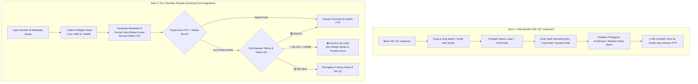

# Adobe Stock QC Agent — Dokumentasi & Panduan Arsitektur

**Versi Modul:** 1.0.0  
**Tanggal Rilis:** 22 Oktober 2026  
**Target:** Asisten Kendali Mutu Pra-Submit (Pre-Submission Quality Control) untuk Aset Masal Adobe Stock (Foto JPEG & PNG Transparan)  
**Mesin AI:** Multi-Cluster Google Apps Script (GAS) AI Proxy (Vision Language Models)  

---

## 1. Ringkasan Eksekutif

Adobe Stock QC Agent adalah modul kendali mutu pra-submit lokal yang bertugas mendeteksi kegagalan teknis, cacat visual AI, teks/merk dagang liar, dan inkonsistensi metadata sebelum kontributor mengunggah aset ke portal Adobe Stock.

### Prinsip Utama Sistem:
1. **Bukan Simulator Moderasi Privat**: Sistem tidak menjamin aset 100% diterima oleh Adobe. Label `READY` bermakna: *"Tidak ditemukan isu pada pengujian yang dikonfigurasi saat ini"*.
2. **Deterministic First**: Pengujian teknis deterministik (resolusi, rasio, ukuran MB, transparansi PNG) dieksekusi secara instan di browser/client tanpa membuang kuota token AI.
3. **Multi-Cluster GAS Proxy VLM**: Seluruh penalaran visual dan kepatuhan kebijakan dialirkan melalui Cluster GAS Proxy (`Cluster-1` dan `Cluster-2`) yang memanfaatkan model Vision Language Model (VLM), seperti Gemini 2.5/2.0 Flash, DeepSeek v4.1 Flash, Qwen 3.8, Pixtral 12B, dan OpenRouter Auto.
4. **Unknown adalah Fakta yang Sah**: Sistem tidak pernah menebak identitas orang nyata, status fiksi, atau hak lisensi AI semata-mata dari piksel gambar. Jika data tidak lengkap, sistem menandainya sebagai `UNKNOWN` dan meminta konfirmasi manusia.
5. **Read-Only / Non-Destructive**: File asli pengguna tidak pernah ditimpa atau diubah secara paksa.

---

## 2. Arsitektur Dua Alur Kerja (Dual-Track Architecture)

Sistem dirancang dengan **dua jalur alur kerja terpadu**:



---

## 3. Jalur 1 — Panduan Penggunaan Tab Mandiri (QC Inspector)

Tab **QC Inspector** dapat diakses melalui bilah navigasi samping (`AppSideRail`) dengan ikon `ShieldCheck`.

### Langkah-Langkah Penggunaan:
1. **Input Aset**:
   - Klik **"Pilih File Gambar"** untuk mengunggah kumpulan file JPEG / PNG dari komputer, atau
   - Klik **"Ambil dari Studio"** untuk langsung menarik aset visual yang sedang aktif di Studio Metadata.
2. **Pilih Model VLM & Tipe Aset**:
   - Dropdown model terhubung langsung ke model VLM di GAS Proxy (`auto`, `gemini-2.5-flash`, `deepseek-v4.1-flash:free`, `qwen/qwen3.8-27b`, dll.).
   - Tipe aset target: *Deteksi Otomatis*, *Foto / JPEG*, atau *PNG Transparan*.
3. **Mulai Audit Masal**:
   - Klik **"Mulai Audit QC"**. Sistem akan memproses setiap file melalui:
     - Tahap 1: *Preflight Teknis* (menghitung dimensi, megapixels, ukuran MB, dan transparansi alpha).
     - Tahap 2: *Inspeksi Visual & Kebijakan VLM* (memeriksa anatomi AI, teks, logo, dan batasan merk).
4. **Pemeriksaan Bukti (Evidence Viewer)**:
   - Klik tombol **"Detail & Bukti"** pada kartu aset untuk membuka drawer detail:
     - Menampilkan dimensi, megapixel aktual, dan status alpha.
     - Menampilkan daftar temuan terperinci, dampak moderasi Adobe, dan saran tindakan.
     - Tombol **"Abaikan Temuan"**: Jika kontributor menilai temuan tersebut adalah efek artistik yang disengaja (misal: bokeh latar belakang atau gaya ilustrasi fantasi), kontributor dapat mengabaikannya agar status berubah menjadi `READY`.
5. **Handoff Langsung**:
   - **"Kirim ke Studio Metadata"**: File yang lolos langsung dipindahkan ke Studio untuk dibuatkan judul dan kata kunci.
   - **"Kirim ke Antrean FTP"**: File yang lolos langsung dipasangkan ke antrean upload multi-agensi.

---

## 4. Jalur 2 — Proteksi Otomatis (*The Adobe Safety Gate*)

Jalur ini terpasang langsung di dalam fitur antrean upload FTP (`FtpQueueView.tsx`) untuk melindungi akun pengguna dari risiko penalti moderasi Adobe Stock.

### Mekanisme Kerja:
1. Pada antrean upload FTP, terdapat sakelar opsi: **`[✓] Proteksi Adobe Stock`** (aktif secara default).
2. Ketika tombol **"Mulai Upload"** ditekan dan target akun adalah **Adobe Stock**:
   - Sistem melakukan verifikasi batas keras resmi Adobe.
   - File yang melanggar batas (misalnya ukuran $> 45$ MB atau resolusi $< 4$ MP) **otomatis ditahan (*Held / Skipped*)**.
   - Item tersebut diberi badge merah dengan alasan pembatalan jelas: *"Ditahan: Ukuran melebihi batas 45 MB Adobe Stock"*.
   - Aset tetap dapat diunggah ke agensi lain (seperti Shutterstock atau Freepik) jika akun target diubah, namun akun Adobe Stock pengguna tetap terlindungi dari penolakan moderasi masal.

---

## 5. Batasan Teknis & Matriks Keputusan (*Decision Matrix*)

| Kriteria Pengujian | Batasan Resmi Adobe Stock | Hasil Evaluasi Sistem |
| :--- | :--- | :--- |
| **Resolusi Gambar** | Minimal 4.0 Megapixels, Maksimal 100.0 Megapixels | $< 4.0$ MP $\rightarrow$ **BLOCK**<br>$> 100.0$ MP $\rightarrow$ **BLOCK** |
| **Ukuran File** | Maksimal 45.0 Megabytes (MB) | $> 45.0$ MB $\rightarrow$ **BLOCK** |
| **Format File** | JPEG untuk foto; PNG untuk ilustrasi terisolasi | Non-JPEG/PNG $\rightarrow$ **BLOCK** |
| **Transparansi PNG** | Wajib *true transparent background* tanpa fringe | 100% Opak $\rightarrow$ **BLOCK**<br>Pinggiran kotor $\rightarrow$ **REVIEW** |
| **Cacat Anatomi AI** | Jari tangan melebur/ekstra, mata cacat, distorsi tubuh | Kerusakan parah $\rightarrow$ **BLOCK**<br>Ambiguitas visual $\rightarrow$ **REVIEW** |
| **IP / Merk Terlarang** | Tercantum dalam *Known Restrictions Watchlist* | Terdeteksi merk $\rightarrow$ **REVIEW / BLOCK** |
| **Semua Cek Lolos** | Memenuhi seluruh syarat teknis dan kebijakan di atas | **READY** |

---

## 6. Struktur File & Modul Kode

```text
c:\App Tools\meta-gen-gue\
├── docs/
│   └── ADOBE_STOCK_QC_AGENT.md        # Dokumentasi teknis & arsitektur (File ini)
├── lib/qc/
│   ├── types.ts                       # Kontrak TypeScript (QcReport, Finding, Decision)
│   ├── rulebook-data.ts               # Pemuat aturan Adobe & scanner Known Restrictions
│   ├── preflight.ts                   # Validator teknis instan di browser (<5ms)
│   ├── decision-engine.ts             # Agregator keputusan deterministik (BLOCK/REVIEW/READY)
│   └── data/                          # Data JSON dari knowledge library v0.1.1
│       ├── adobe_stock_rulebook.json
│       ├── known_restrictions_watchlist.json
│       └── visual_qc_taxonomy.json
├── app/api/qc/
│   └── inspect/route.ts               # Endpoint Edge API penghubung ke Cluster GAS Proxy VLM
├── components/
│   ├── QcAgentView.tsx                # Antarmuka utama Tab QC Inspector (Jalur 1)
│   ├── QcStatusBadge.tsx              # Komponen badge status (READY / REVIEW / BLOCK)
│   ├── AppSideRail.tsx                # Navigasi tab 'qc-agent' di bilah menu
│   ├── StudioPanel.tsx                # Tombol pintas audit kualitas dari Studio
│   └── FtpQueueView.tsx               # Proteksi otomatis Adobe Safety Gate (Jalur 2)
└── lib/__tests__/
    └── qc.test.ts                     # Unit test otomatis (Vitest)
```

---

## 7. Pemeliharaan & Pembaruan Kebijakan

1. **Pembaruan Aturan Adobe**:
   - Jika terdapat pembaruan kebijakan di portal Adobe Contributor HelpX, edit file [`lib/qc/data/adobe_stock_rulebook.json`](file:///c:/App%20Tools/meta-gen-gue/lib/qc/data/adobe_stock_rulebook.json) atau tambahkan entitas merk baru pada [`lib/qc/data/known_restrictions_watchlist.json`](file:///c:/App%20Tools/meta-gen-gue/lib/qc/data/known_restrictions_watchlist.json).
2. **Koneksi GAS Proxy**:
   - Konfigurasi URL dan token kluster proxy disimpan di file `.env.local` (`GAS_PROXY_URL_1`, `GAS_PROXY_URL_2`, `GAS_PROXY_TOKEN_1`, `GAS_PROXY_TOKEN_2`).
