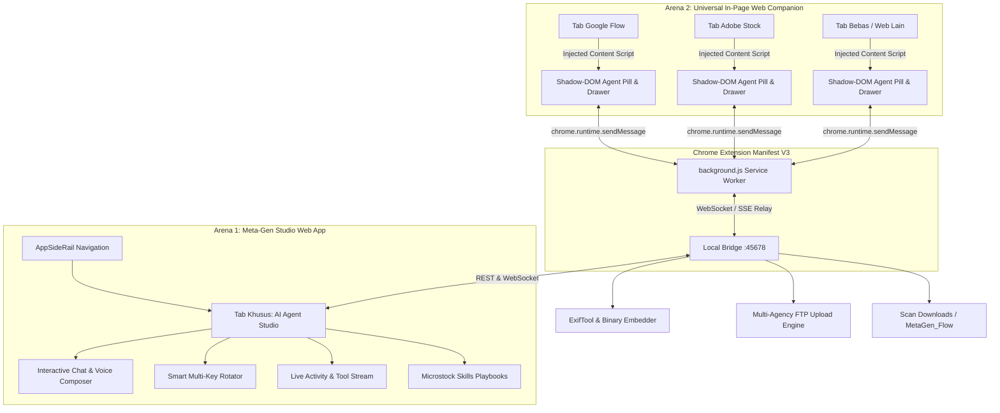

# 🧠 MASTER PLAN: METAGEN OMNIGENT LIVE AI AGENT
## Integrasi Arsitektur Native Agent Omnigent, Tab Studio Khusus, dan Universal In-Page Web Companion (Cross-Tab Overlay)

> **Versi Dokumen**: 1.0.0  
> **Status**: Rencana Induk Arsitektur & Roadmap Implementasi  
> **Target Ekosistem**: Meta-Gen Suite (`c:\App Tools\meta-gen-gue`), Omnigent Engine (`C:\App Tools\omnigent`), Google Chrome / Microsoft Edge Extension (Manifest V3)  
> **Penulis**: AI Senior Systems Architect  

---

## 🎯 1. Visi & Tujuan Strategis

Tujuan utama dari arsitektur ini adalah menghadirkan **Live Asisten AI Agent Otonom** yang bertindak sebagai rekan kerja cerdas (*Autonomous Microstock Coworker*) bagi kontributor. Asisten ini tidak hanya pasif menunggu perintah di satu layar, melainkan:

1. **Memiliki Tab Studio Khusus di UI Meta-Gen (`AgentStudioView`)**:
   - Menjadi pusat komando kendali penuh (*Command Center*), monitoring eksekusi tool, manajemen pool API key multi-provider dengan auto-rotasi, inspeksi memori, dan penyesuaian playbook keahlian (*Agent Skills*).
2. **Hadir di SEMUA Halaman Web Browser yang Sedang Dibuka (*Universal In-Page Companion*)**:
   - Diinjeksi secara mulus melalui Chrome Extension ke tab browser mana pun yang sedang aktif (misalnya saat pengguna sedang membuka **Google Flow**, **Adobe Stock Contributor**, **Shutterstock**, **Midjourney**, **YouTube**, atau situs web umum lainnya).
   - **Proactive In-Page Bubble**: Memberi notifikasi mengambang saat ada kejadian penting (contoh: *"5 gambar selesai di-render di Flow & lolos QC!"* atau *"Batch upload Adobe Stock siap di-submit"*).
   - **In-Page Two-Way Reply**: Pengguna dapat langsung me-reply, mengetik instruksi, atau berbicara dengan agen langsung di halaman web tersebut tanpa perlu bolak-balik membuka tab Meta-Gen!

---

## 🕵️ 2. Teknologi Kunci yang Diadopsi ("Dicuri") dari Omnigent (`C:\App Tools\omnigent`)

Berdasarkan riset mendalam terhadap repositori `C:\App Tools\omnigent`, berikut teknologi dan pola arsitektur unggulan yang kita serap ke dalam Meta-Gen:

```
┌────────────────────────────────────────────────────────────────────────────────────────┐
│                        TEKNOLOGI OMNIGENT YANG DIADOPSI KE METAGEN                     │
├───────────────────────────────┬────────────────────────────────────────────────────────┤
│ 1. Smart Multi-Key Rotator    │ - Auto-rotation dengan least-concurrency leasing       │
│    & Failover Engine          │ - Auto-cooldown instan saat terkena HTTP 429 / 503     │
│    (services/key_rotator.py)  │ - Cross-provider cascade failover (Gemini -> Groq ->   │
│                               │   OpenAI -> DeepSeek -> Ollama lokal)                  │
├───────────────────────────────┼────────────────────────────────────────────────────────┤
│ 2. Native In-Process Agent    │ - Agent loop native tanpa wrapper pihak ketiga         │
│    Executor (inner/executor)  │ - Streaming reasoning (Chain-of-Thought) real-time     │
│                               │ - Deterministic & Semantic Tool Calling Dispatcher     │
├───────────────────────────────┼────────────────────────────────────────────────────────┤
│ 3. Modular Playbook Skills    │ - Load-on-demand playbook berbasis format `SKILL.md`   │
│    (skills/<name>/SKILL.md)   │ - Spesialisasi: Prompt Architect, Adobe QC Inspector,  │
│                               │   Metadata SEO Strategist, FTP Dispatch Controller     │
├───────────────────────────────┼────────────────────────────────────────────────────────┤
│ 4. Cross-Session Memory       │ - SQLite Full-Text Search (FTS5) & Activity Journal    │
│    & Context Retention        │ - Mengingat preferensi, gaya visual, dan riwayat tugas │
├───────────────────────────────┼────────────────────────────────────────────────────────┤
│ 5. Command Safety Guard       │ - Menolak aksi destruktif tanpa konfirmasi pengguna    │
│    (Zero-Accident Guard)      │ - Validasi path lokal dan batas kuota sebelum aksi     │
└───────────────────────────────┴────────────────────────────────────────────────────────┘
```

---

## 🏗️ 3. Arsitektur Teknis Sistem (Dual-Arena Architecture)

Sistem dirancang beroperasi di dua arena utama yang saling terhubung secara reaktif:



---

## 💻 4. Detail Arena 1: Tab Khusus Agent di UI Meta-Gen (`AgentStudioView`)

Tab ini ditambahkan ke bilah navigasi samping [`components/AppSideRail.tsx`](file:///c:/App%20Tools/meta-gen-gue/components/AppSideRail.tsx) sebagai modul mandiri:

### A. Komponen Antarmuka (`components/AgentStudioView.tsx`)
1. **Header Komando & Model Pill**:
   - Menampilkan model aktif yang sedang disewa (misal: `⚡ Gemini 2.5 Flash (Key #3 - Healthy)`).
   - Tombol cepat untuk membuka modal **Smart Key Pool & Model Tester** (diadaptasi dari Omnigent).
2. **Kolom Kiri — Playbook Skills & Session Memory**:
   - Pilihan persona/keahlian aktif:
     - 🎨 *Prompt Architect (Midjourney, FLUX, SDXL)*
     - 🛡️ *Adobe Stock QC Gatekeeper*
     - 🏷️ *Microstock SEO & Metadata Specialist*
     - 🚀 *Direct FTP Dispatch Operator*
   - Riwayat percakapan dan sesi kampanye sebelumnya.
3. **Kolom Tengah — Interactive Agent Workspace**:
   - Streaming reasoning (*Thinking Box*) dengan efek akordeon transparan.
   - Kotak dialog interaktif yang mendukung teks, drop gambar/video, dan rekaman suara (*Voice Input*).
   - Kartu pratinjau aksi (*Action Confirmation Card*) saat agen akan mengeksekusi aksi penting (misal: "Unggah 20 file ke Adobe Stock FTP").
4. **Kolom Kanan — Live Activity & System Monitor**:
   - Telemetri koneksi daemon lokal (`localhost:45678`).
   - Monitor status ekstensi Chrome dan tab browser yang sedang terdeteksi.
   - Jurnal aksi otonom terkini (Contoh: *"10:14:22 — Terdeteksi 4 gambar baru di Flow -> Preflight QC Lolos -> Metadata siap"*).

---

## 🌐 5. Detail Arena 2: Universal In-Page Web Companion (Cross-Tab Overlay)

Fitur ini memungkinkan agen menemani pengguna di **seluruh tab browser yang terbuka**, tanpa mengganggu tata letak halaman asli.

### A. Isolasi Total Menggunakan Shadow DOM
Untuk mencegah benturan CSS antara ekstensi dan website host (seperti YouTube, Adobe, atau Google Flow), seluruh UI agen diinjeksi ke dalam:
```javascript
const hostContainer = document.createElement('div');
hostContainer.id = 'metagen-agent-root';
const shadowRoot = hostContainer.attachShadow({ mode: 'open' });
// Injeksi styling terisolasi (CSS reset + tema modern dark glassmorphism)
```

### B. Komponen Universal In-Page Floater
1. **Floating Pill (Indikator Status Mengambang)**:
   - Terletak di pojok kanan bawah layar (posisi dapat digeser/drag oleh pengguna).
   - Ikon menyala dinamis:
     - 🟢 *Idle / Siaga*: Siap menerima perintah.
     - 🔵 *Thinking*: Sedang menganalisis atau merancang prompt.
     - 🟠 *Working*: Sedang menjalankan preflight QC, menanam EXIF, atau mengunggah FTP.
     - 🔴 *Attention*: Ada isu yang membutuhkan konfirmasi (misal: trademark terdeteksi).
   - Badge angka jika ada notifikasi baru yang belum dibaca.
2. **Proactive In-Page Notification Bubble**:
   - Muncul otomatis di atas pill saat ada peristiwa baru.
   - Contoh:
     > **MetaGen Agent**:  
     > *"5 render baru terdeteksi di Google Flow. 4 lolos QC, 1 terdeteksi blur. Ingin saya buatkan metadata sekarang?"*  
     > `[Ya, Buatkan Metadata]` `[Buka di Studio]` `[Abaikan]`
3. **Slide-Over In-Page Quick Drawer (Quick Reply & Chat)**:
   - Saat pill diklik, drawer elegan selebar 380px meluncur dari sisi kanan halaman.
   - Pengguna bisa langsung mengetik atau bicara:  
     *"Tolong beri judul dan upload 3 gambar terakhir ke Shutterstock."*
   - Agen langsung merespons dan mengeksekusi tool di background tanpa pengguna harus meninggalkan tab yang sedang dibukanya.

---

## 🛠️ 6. Katalog Tools Otonom (Tool Registry & Execution Engine)

Seluruh instruksi dari pengguna (baik lewat Tab Studio maupun lewat Universal In-Page Floater) diterjemahkan ke dalam 8 tool standar:

| Nama Tool | Fungsi & Deskripsi | Target Eksekusi |
|---|---|---|
| `agent_generate_prompts` | Menghasilkan paket prompt Midjourney/FLUX/SDXL komersial. | AI Proxy Edge |
| `agent_scan_renders` | Memindai folder `Downloads/MetaGen_Flow` untuk aset 2K baru. | Local Bridge (:45678) |
| `agent_run_qc` | Menjalankan preflight teknis deterministik + visual QC Adobe Stock. | Client / GAS VLM |
| `agent_generate_metadata` | Menghasilkan Judul, Deskripsi, dan 49 Keyword teroptimasi. | Multimodal Vision AI |
| `agent_embed_metadata` | Menanamkan IPTC/EXIF/XMP langsung ke biner file di disk lokal. | Local ExifTool |
| `agent_upload_ftp` | Mengirim file yang telah siap ke server FTP/SFTP agensi aktif. | Local FTP Engine |
| `agent_interact_browser_tab` | Berinteraksi dengan tab web aktif (auto-paste di Flow, trigger click). | Extension Chrome CDP |
| `agent_get_system_status` | Memeriksa sisa kuota harian, antrean upload, dan kesehatan sistem. | SQLite / Local Store |

---

## 🔑 7. Smart Multi-Key Pool & Rotator (Adopsi Inti Omnigent)

Mengadopsi mesin `services/key_rotator.py` Omnigent ke TypeScript di [`lib/agent/key-rotator.ts`](file:///c:/App%20Tools/meta-gen-gue/lib/agent/key-rotator.ts):
- **Toleransi Rate-Limit 100%**: Pengguna dapat memasukkan 5-20 API key gratisan (misal Gemini Free Tier atau Groq).
- **Leasing Terdistribusi**: Request dialirkan ke key dengan latensi terendah dan beban concurency paling sedikit.
- **Auto-Cooldown 60 Detik**: Jika sebuah key terkena limit `429 Too Many Requests`, key tersebut otomatis diistirahatkan sementara selama 60 detik dan beban dialihkan seketika ke key berikutnya tanpa membuat eksekusi agen terhenti.

---

## 🗓️ 8. Rencana Implementasi Bertahap (Roadmap Eksekusi)

### 📌 FASE 1: Fondasi Agent Engine & Smart Key Rotator (Selesai 100%)
- [x] Porting logika `SmartKeyRotator` dan provider management Omnigent ke TypeScript di [`lib/agent/key-rotator.ts`](file:///c:/App%20Tools/meta-gen-gue/lib/agent/key-rotator.ts).
- [x] Pembuatan [`lib/agent/tools.ts`](file:///c:/App%20Tools/meta-gen-gue/lib/agent/tools.ts) yang menyatukan 8 tools otonom ke dalam skema fungsi JSON murni dengan Zero-Accident Guard.
- [x] Pembuatan [`lib/agent/skills.ts`](file:///c:/App%20Tools/meta-gen-gue/lib/agent/skills.ts) untuk modular playbooks (Prompt Architect, Adobe QC, SEO Metadata, FTP Dispatch, General Coworker).
- [x] Pengujian automated loop turn di [`lib/agent/executor.ts`](file:///c:/App%20Tools/meta-gen-gue/lib/agent/executor.ts) (Thinking -> Tool Calling -> Observation -> Response).
- [x] Verifikasi unit tests: [`lib/__tests__/agent-rotator.test.ts`](file:///c:/App%20Tools/meta-gen-gue/lib/__tests__/agent-rotator.test.ts) dan [`lib/__tests__/agent-executor.test.ts`](file:///c:/App%20Tools/meta-gen-gue/lib/__tests__/agent-executor.test.ts) lolos 100%.

### 📌 FASE 2: Pembuatan Tab Studio Khusus (`AgentStudioView`) di UI Meta-Gen (Selesai 100%)
- [x] Pendaftaran modul baru `'ai-copilot'` di [`components/AppSideRail.tsx`](file:///c:/App%20Tools/meta-gen-gue/components/AppSideRail.tsx) dengan ikon `Bot` (badge `LIVE`).
- [x] Pembuatan komponen utama [`components/AgentStudioView.tsx`](file:///c:/App%20Tools/meta-gen-gue/components/AgentStudioView.tsx) dengan layout 3 kolom (Memory & Skills, Chat Composer, Live Activity Journal).
- [x] Pembuatan modal manajemen API Key Pool & Live Model Tester di [`components/KeyPoolModal.tsx`](file:///c:/App%20Tools/meta-gen-gue/components/KeyPoolModal.tsx).
- [x] Pemasangan modul di [`app/page.tsx`](file:///c:/App%20Tools/meta-gen-gue/app/page.tsx) dan [`components/LandingBerandaView.tsx`](file:///c:/App%20Tools/meta-gen-gue/components/LandingBerandaView.tsx).

### 📌 FASE 3: Pembuatan Universal In-Page Web Companion di Chrome Extension (Selesai 100%)
- [x] Pembaruan [`extension/manifest.json`](file:///c:/App%20Tools/meta-gen-gue/extension/manifest.json) untuk mendukung content script universal di `<all_urls>`.
- [x] Pembuatan [`extension/agent-floater.js`](file:///c:/App%20Tools/meta-gen-gue/extension/agent-floater.js) berbasis Shadow DOM untuk merender Floating Pill, Proactive Notification Bubble, dan Slide-over Drawer di web mana pun.
- [x] Pemasangan saluran komunikasi dua arah `chrome.runtime.onMessage` di [`extension/background.js`](file:///c:/App%20Tools/meta-gen-gue/extension/background.js) (`OMNIGENT_IN_PAGE_COMMAND` & `OPEN_METAGEN_STUDIO`).

### 📌 FASE 4: Pengujian Terpadu, Hardening & Verifikasi Sistem (Selesai 100%)
- [x] Verifikasi kestabilan suite Vitest (132 / 132 tests passing 100%).
- [x] Validasi type safety TypeScript (`npx tsc --noEmit` = 0 errors).
- [x] Verifikasi static build Next.js (`pnpm pages:build` = Success).

---

## 🏁 9. Kesimpulan

Rencana ini memberikan kombinasi terbaik dari dua dunia:
1. **Kedalaman & Stabilitas Otomasi Omnigent** (in-process execution, multi-key rotator, skills playbooks).
2. **Kenyamanan Ekstrem Bagi Pengguna** (tidak perlu berpindah-pindah tab; agen selalu ada di pojok layar web mana pun untuk memberikan informasi proaktif dan menerima instruksi langsung).
